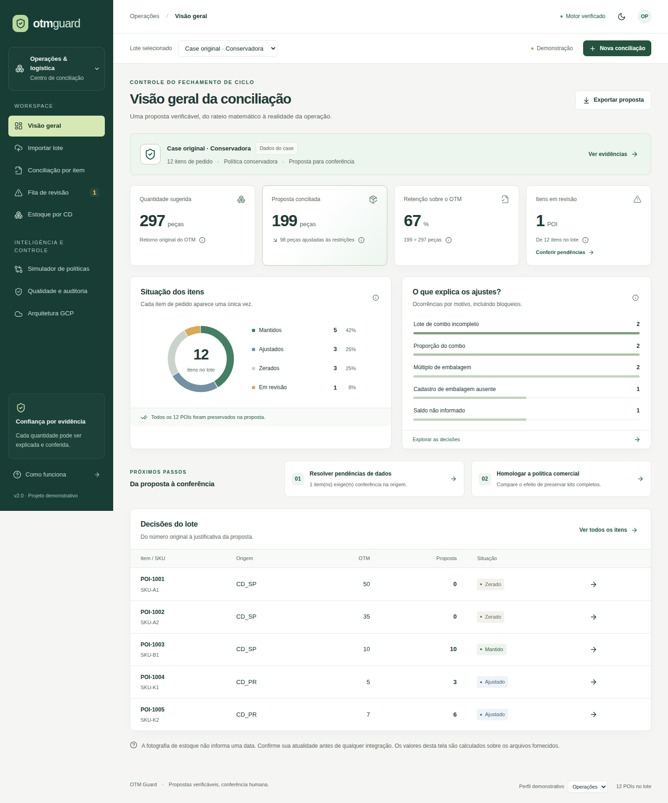

# OTM Guard · Operations Reconciliation & Decision Intelligence

Uma camada externa ao OTM que transforma seu rateio em **propostas verificáveis por POI**, respeitando demanda, estoque, combos e caixas simultaneamente. O motor, as cinco bases e os exemplos originais permanecem preservados.

A versão 2 acrescenta API, interface operacional, persistência, execução assíncrona, auditoria e preparação para GCP. **Case demonstrativo de Crizan Belém Ribeiro; não é produto oficial nem homologado pelo Grupo Boticário.**



## Resultado das bases originais

| Indicador | Resultado |
| --- | ---: |
| POIs / demanda | 12 / 455 peças |
| Sugestão OTM | 297 peças |
| Proposta padrão `strict` | **199 peças** |
| Alternativa `complete-kits` | **269 peças** |
| Verificações em cada cenário | **10 de 10** |
| Item em revisão | SKU-GHOST: faltam retorno e cadastros |

Em strict: 5 itens mantidos, 3 ajustados, 3 zerados e 1 em revisão. O combo Dia das Mães, sugerido em 50:35, fica 0:0 no padrão e 35:35 na alternativa. A diferença de 70 peças exige decisão comercial; não representa economia financeira.

## Executar a aplicação

**Docker Compose:** Docker com Compose v2; conexão para construir a imagem.

```bash
git clone https://github.com/belemcrizan/Case_boticario.git
cd Case_boticario
git checkout feat/otm-guard-enterprise
docker compose up --build
```

Abra **http://localhost:8080**. Escolha “Acessar como analista”. Os dois cenários são preparados localmente. Não exige conta GCP, chave de API ou LLM. O volume mantém lotes e resultados. Use Ctrl+C para encerrar.

**Desenvolvimento:** Python 3.12, Node.js 24 e [uv](https://docs.astral.sh/uv/). Instalação precisa de rede; a demonstração instalada funciona localmente.

```bash
uv sync --frozen --extra api --extra dev --extra gcp --extra analysis
npm --prefix frontend ci --ignore-scripts
npm --prefix frontend run build
.venv/bin/python -m platform_api.api
```

Abra **http://localhost:8000**. A API serve o frontend compilado sob a mesma origem. No Windows, use o executável Python da pasta Scripts do ambiente virtual. Dados novos ficam em `.runtime/`. Não exponha o modo demo na internet: os perfis são identidades locais de demonstração.

## Execução original por terminal

Continua usando apenas a biblioteca padrão do **Python 3.11+**, sem instalar a plataforma:

```bash
python app.py --output-dir output-novo
python app.py --incomplete-policy complete-kits --output-dir output-kits-novo
python scripts/check_examples.py
python -m unittest discover -s tests -t . -v
```

Abra o `relatorio.html` gerado. Não reutilize um diretório de saída: evidências anteriores não são sobrescritas. Os [exemplos originais](examples/) incluem CSVs, manifesto e relatório offline.

## O produto

| Perspectiva | Experiência |
| --- | --- |
| Gestão | KPIs com denominadores, situações, riscos e comparação de políticas |
| Operação | Importação de cinco CSVs, busca e filtros, decisões e fila de revisão |
| Engenharia e auditoria | Dez invariantes, identidade, hashes, tempos, eventos e integridade |

O painel de um POI explica o cálculo deterministicamente: 110 peças em caixas de seis resultam em **108 peças, 18 caixas**. Simular cria outra execução, preservando a origem. Tabelas consultam páginas de até 100 itens; o relatório offline de lotes grandes mostra amostra explícita de 200 itens, com CSV completo.

FastAPI oferece contratos tipados, limites de upload, idempotência, autorização por recurso, concorrência e retries limitados. O modo GCP usa IAP, Cloud SQL com IAM, GCS imutável e Cloud Run Jobs. Não há reserva real de estoque, aprovação de faturamento nem escrita no OMS.

## Documentação e evidências

| Leitura | Conteúdo |
| --- | --- |
| [Brief executivo](docs/EXECUTIVE_BRIEF.md) | Problema, valor, riscos e adoção |
| [Entrega e aderência](docs/ENTREGA_FINAL.md) | Comparação com baseline, checklist e arquivos |
| [Guia da interface](docs/GUIA_INTERFACE.md) | Jornadas, indicadores e glossário |
| [Demonstração de 5–7 minutos](docs/DEMONSTRACAO.md) | Sequência para entrevista e perguntas |
| [Apresentação executiva](docs/presentation/OTM_Guard_Executivo_Final.pptx) | Oito slides editáveis com notas |
| [Evidências](docs/EVIDENCIAS.md) | Testes, acessibilidade, segurança e CI |
| [API, dados e sequência](docs/API_E_DADOS.md) | Endpoints, autenticação, erros, modelo e fluxo |
| [OpenAPI](docs/api/openapi.json) | Contrato versionado; também em /docs e /openapi.json |
| [Arquitetura GCP](docs/ARQUITETURA_GCP.md) | Componentes, estados, IAM e persistência |
| [Operação enterprise](docs/OPERACAO_ENTERPRISE.md) | Recuperação, homologação, canário e rollback |
| [Modelo de ameaças](docs/MODELO_AMEACAS.md) | Controles e riscos residuais |
| [Políticas comerciais](docs/POLITICAS_COMERCIAIS.md) | Premissas, ambiguidades e MILP |
| [Performance e custos](docs/PERFORMANCE_E_CUSTOS.md) | Benchmarks e premissas financeiras |
| [Observabilidade e valor](docs/OBSERVABILIDADE_E_VALOR.md) | Métricas, SLO proposto e piloto |
| [Auditoria inicial](docs/AUDITORIA_INICIAL.md) | Estado anterior e SHA |

Referência do núcleo original: [aderência](docs/ADERENCIA.md), [matemática](docs/ARQUITETURA.md), [contratos CSV](docs/CONTRATOS.md), [resultados por POI](docs/RESULTADOS.md) e [validação original](docs/VALIDACAO.md).

## Verificar

```bash
.venv/bin/coverage run -m pytest -q
.venv/bin/coverage report --fail-under=90
.venv/bin/ruff check platform_api platform_tests scripts/benchmark_e2e.py
.venv/bin/ruff format --check platform_api platform_tests scripts/benchmark_e2e.py
.venv/bin/mypy platform_api
.venv/bin/python -m scripts.export_openapi --check
npm --prefix frontend run lint
npm --prefix frontend run typecheck
npm --prefix frontend test
npm --prefix frontend run build
```

Playwright, scanner de imagem, SBOM e Terraform integram os [workflows](.github/workflows/enterprise.yml). Consulte [EVIDENCIAS.md](docs/EVIDENCIAS.md) para escopo e reprodução.

## Maturidade e limites

O benchmark sintético local de **1 milhão de POIs** levou **152,31 s**, pico de **1.456,53 MiB RSS**, incluindo CSV, motor, verificação, artefatos, SQLite e primeira página. Não inclui rede GCP, usuários concorrentes ou reserva de estoque. Não estabelece SLA produtivo.

**Não foi realizado deploy ou validação em ambiente GCP, nem homologação para produção.** Antes de uso real: homologar política, identificar instâncias de combo, datar o snapshot, testar identidade, grants, recuperação, carga e contrato transacional OMS/WMS. IA permanece projeto opcional somente leitura, sem dependência de Vertex AI.
