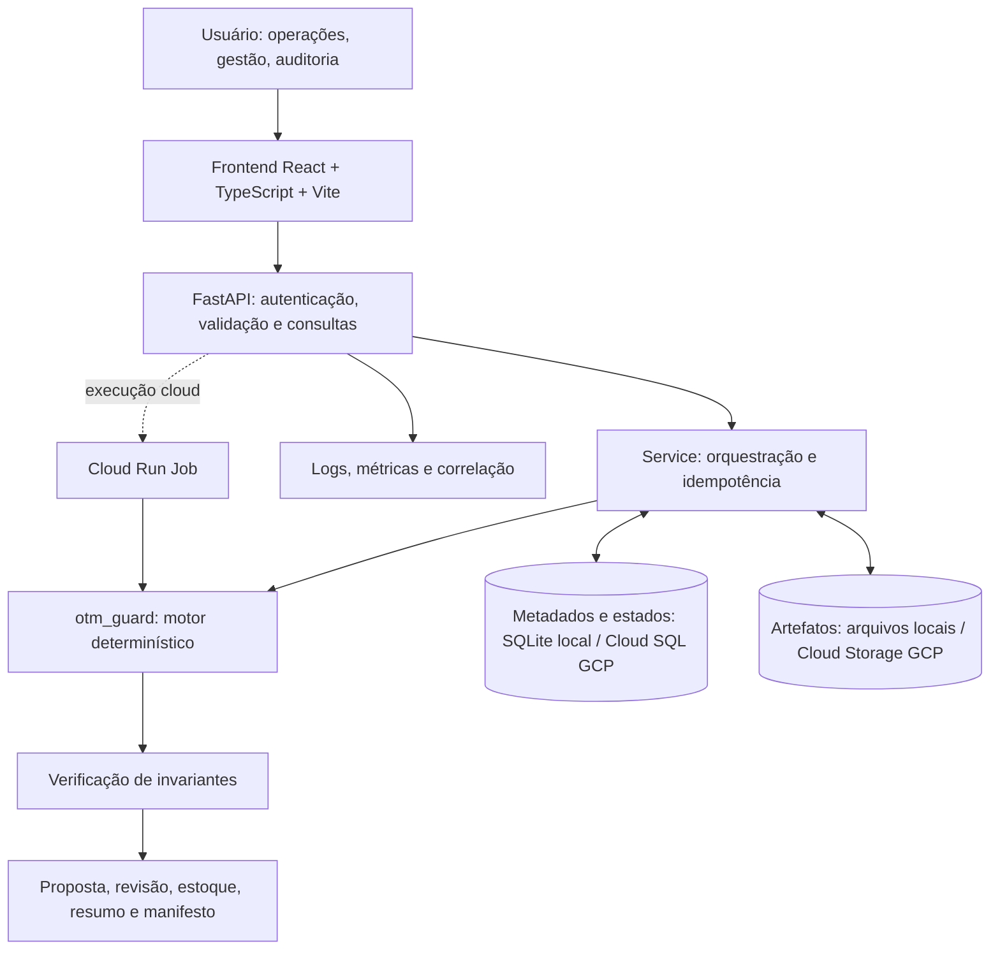
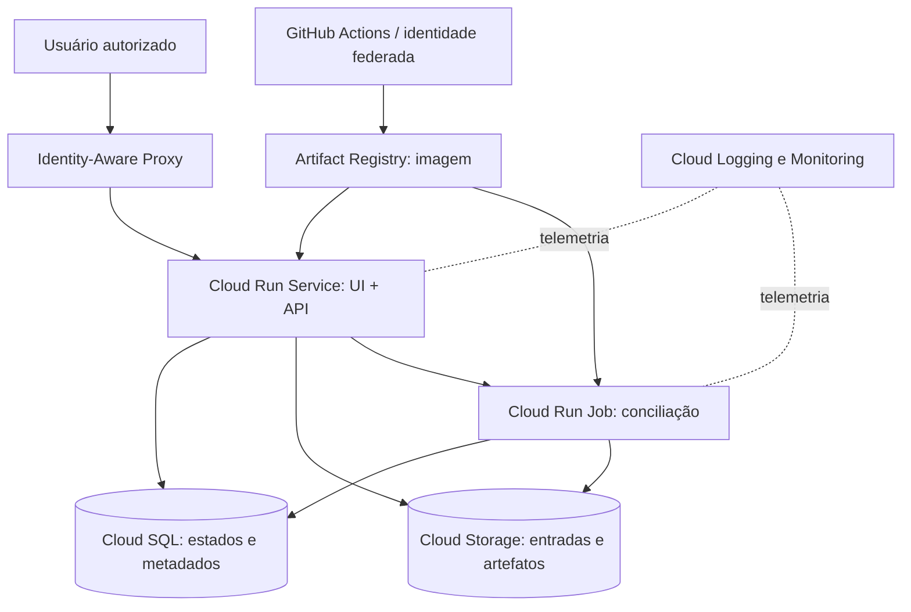

# OTM Guard Enterprise

**Plataforma de conciliação pós-OTM para operações e logística**  
**Case AI Engineer — Grupo Boticário | Projeto demonstrativo independente**

> Uma camada externa ao OTM que transforma sugestões de saída em propostas auditáveis, respeitando demanda, estoque por centro de distribuição, proporções de combos e múltiplos de embalagem. **Não altera o OTM, não reserva estoque e não autoriza faturamento.**

[](https://github.com/belemcrizan/Case_boticario/actions/workflows/ci.yml) [](https://github.com/belemcrizan/Case_boticario/actions/workflows/enterprise.yml)

**Repositório:** https://github.com/belemcrizan/Case_boticario  
**Autor:** Crizan Belém Ribeiro

## Sumário

1. [Visão geral e problema de negócio](#visão-geral-e-problema-de-negócio)
2. [Resultados verificáveis do case](#resultados-verificáveis-do-case)
3. [Arquitetura da solução](#arquitetura-da-solução)
4. [Funcionalidades](#funcionalidades)
5. [Como executar no Windows](#como-executar-no-windows)
6. [Execução com Docker](#execução-com-docker)
7. [Motor independente via CLI](#motor-independente-via-cli)
8. [Contratos e regras de negócio](#contratos-e-regras-de-negócio)
9. [API e segurança](#api-e-segurança)
10. [Testes e qualidade](#testes-e-qualidade)
11. [Arquitetura GCP](#arquitetura-gcp)
12. [Estrutura do repositório](#estrutura-do-repositório)
13. [Demonstração para avaliadores](#demonstração-para-avaliadores)
14. [Limitações e próximos passos](#limitações-e-próximos-passos)
15. [Solução de problemas](#solução-de-problemas)

## Visão geral e problema de negócio

Em uma operação de fechamento de ciclo, as quantidades propostas pelo sistema de transporte (OTM) podem não satisfazer, simultaneamente, todas as regras comerciais e logísticas necessárias ao faturamento. Exemplos: kits com proporções obrigatórias, caixas master indivisíveis, estoque insuficiente e cadastros incompletos.

O **OTM Guard** atua **depois** da sugestão do OTM, sem modificar seu algoritmo. Recebe cinco CSVs do case, valida os contratos, calcula uma proposta conservadora, verifica invariantes e publica resultados explicáveis por item de pedido (POI). Uma plataforma web adiciona importação, consulta, comparação de políticas, fila de revisão e trilha de auditoria.

**Públicos:** operações e logística, analistas de dados, engenharia, auditoria e gestores. O dashboard comunica resultados em linguagem de negócio; a trilha técnica preserva o cálculo e suas evidências.

## Resultados verificáveis do case

Os números abaixo correspondem **aos cinco CSVs de exemplo fornecidos**, não a indicadores de produção:

| Indicador | Política `strict` | Política `complete-kits` |
|---|---:|---:|
| POIs do OMS | 12 | 12 |
| Demanda | 455 peças | 455 peças |
| Sugestão associada do OTM | 297 peças | 297 peças |
| **Proposta conciliada** | **199 peças** | **269 peças** |
| Retenção sobre sugestão OTM | **67,0%** | **90,57%** |
| POIs em revisão | 1 | 1 |
| Invariantes | 10/10 aprovadas | 10/10 aprovadas |

Na política conservadora, os 12 itens ficam distribuídos em **5 mantidos, 3 ajustados, 3 zerados e 1 em revisão**. A diferença de 98 peças entre OTM e proposta **não é uma estimativa de economia ou perda financeira**: decorre das restrições aplicadas à massa de exemplo.

**Exemplos concretos:**

- **Combo de barba:** proporção 1 aparelho : 2 cargas. Com OTM de 5 aparelhos e 7 cargas, cabem 3 kits: proposta de **3 aparelhos e 6 cargas**.
- **Embalagem:** sugestão de 110 peças com caixa de 6 resulta em **108 peças (18 caixas)**.
- **Combo Dia das Mães:** sugestão 50:35 com proporção 1:1. A política `strict` zera o grupo; `complete-kits` admite 35:35. A interpretação de “zerar se incompleto” **é premissa comercial pendente de homologação**.
- **SKU-GHOST:** ausência de dados necessários gera bloqueio e revisão, nunca autorização implícita.

Evidências reproduzíveis: [`examples/strict/`](examples/strict/) e [`examples/complete-kits/`](examples/complete-kits/).

## Arquitetura da solução



### Camadas e responsabilidades

| Camada | Diretório | Responsabilidade |
|---|---|---|
| Domínio e cálculo | `otm_guard/` | Ingestão, regras, alocação, verificação e relatório offline |
| Casos de uso | `platform_api/service.py` | Validar, criar lotes, executar, simular e recuperar resultados |
| API HTTP | `platform_api/api.py` | FastAPI, contratos, endpoints, upload, resposta e frontend compilado |
| Identidade | `platform_api/auth.py` | Sessões demo, papéis, CSRF; validação de identidade IAP no modo GCP |
| Persistência | `platform_api/repository.py` | Lotes, estados, metadados e controle de concorrência |
| Artefatos | `platform_api/storage.py`, `cloud.py` | Armazenamento local e integração GCS |
| Observabilidade | `platform_api/observability.py` | Eventos estruturados, métricas e rastreamento |
| Worker | `platform_api/worker.py` | Execução de lotes em Cloud Run Jobs |
| Interface | `frontend/src/` | Dashboard, importação, consulta, revisão, simulação e auditoria |
| Infraestrutura | `infra/` | Terraform para recursos GCP |
| Qualidade | `tests/`, `platform_tests/`, `frontend/e2e/` | Testes do motor, plataforma e fluxos web |

### Fluxo operacional

1. O usuário seleciona o lote de demonstração ou importa os cinco CSVs.
2. A API valida nomes, formato, cardinalidade e limites das entradas.
3. O serviço registra a execução e sua identidade/idempotência.
4. O motor calcula quantidades viáveis, sem aumentar pedido nem sugestão OTM.
5. O verificador recalcula as invariantes e bloqueia publicação inconsistente.
6. Resultados e evidências são publicados; a interface apresenta indicadores e decisões por POI.
7. Itens com dados ausentes ou ambíguos permanecem em revisão humana.

A proposta é **para conferência**. A plataforma não executa faturamento nem reservas transacionais de estoque.

## Funcionalidades

- **Visão geral:** quantidade sugerida, conciliada, retenção, itens em revisão e causas de ajuste.
- **Importar lote:** validação das cinco entradas e execução controlada.
- **Conciliação por item:** consulta, filtros, detalhes e justificativas.
- **Fila de revisão:** identificação de dados ausentes ou inconsistentes.
- **Estoque por CD:** consumo proposto e saldo simulado por SKU/CD.
- **Simulador de políticas:** comparação de `strict` e `complete-kits` sem alterar a proposta original.
- **Qualidade e auditoria:** invariantes, hashes, artefatos e rastreabilidade.
- **Arquitetura GCP:** visão de evolução cloud da aplicação.
- **Exportação:** resultados em formatos apropriados para conferência e análise.

## Como executar no Windows

### Pré-requisitos

- **Git**;
- **Python 3.11+** (Python 3.12 recomendado);
- **Node.js** compatível com o projeto (Node 24 utilizado na CI);
- **npm**;
- PowerShell e navegador moderno.

> **Importante:** use um ambiente Python virtual exclusivo. Instalar `requirements-api.lock` globalmente pode causar conflitos com outros projetos Python (Uvicorn, OpenTelemetry, Streamlit, protobuf etc.).

### 1. Clonar ou atualizar

```powershell
# Se ainda não clonou:
git clone https://github.com/belemcrizan/Case_boticario.git
cd Case_boticario

# Se já tem a pasta:
git status
git pull origin main
```

Se houver alterações locais, preserve-as antes de executar o pull. Confirme a versão:

```powershell
git log -1 --oneline
```

### 2. Criar ambiente virtual e instalar a API

Execute **na raiz do repositório**:

```powershell
py -3.12 -m venv .venv
.\.venv\Scripts\python.exe -m pip install --require-hashes -r requirements-api.lock
```

Se `py -3.12` não existir, use `python -m venv .venv` com Python 3.11 ou superior. Não é necessário ativar o ambiente para usar os comandos acima.

### 3. Iniciar a API (terminal A)

```powershell
.\.venv\Scripts\python.exe -m uvicorn platform_api.api:create_app --factory --reload --host 127.0.0.1 --port 8000
```

**Atenção:** `platform_api.api` expõe a função `create_app()`, **não** uma variável global `app`. Portanto, `uvicorn platform_api.api:app` produz `Attribute "app" not found`.

Verifique:

- **Saúde:** http://127.0.0.1:8000/healthz
- **Prontidão:** http://127.0.0.1:8000/readyz
- **Documentação OpenAPI:** http://127.0.0.1:8000/docs

A API deve continuar aberta nesse terminal.

### 4. Iniciar a interface (terminal B)

Abra outro PowerShell na raiz:

```powershell
cd frontend
npm ci
npm run dev
```

Abra **http://localhost:5173** (ou a porta indicada pelo Vite). O Vite encaminha requisições `/api` para `http://127.0.0.1:8000`.

**Dica:** não feche o terminal A enquanto estiver usando a interface no terminal B. Na demonstração, selecione um perfil demo adequado; `viewer` e `auditor` são de consulta, enquanto `operator` e `admin` podem realizar operações permitidas no modo demo.

### Alternativa: executar a aplicação unificada em uma porta

Após instalar as dependências Python e Node:

```powershell
cd frontend
npm ci
npm run build
cd ..
.\.venv\Scripts\python.exe -m platform_api.api
```

Abra **http://localhost:8000**. Nesse modo, o FastAPI serve o frontend compilado de `frontend/dist`, além da API. Essa alternativa é prática para demonstrações, sem dois servidores de desenvolvimento.

### 5. Verificar a experiência

1. Abra **Visão geral** e confira 297 / 199 / 67% / 1 revisão.
2. Acesse **Conciliação por item** e examine um POI ajustado.
3. Abra **Fila de revisão** e confira o item bloqueado.
4. Compare políticas no **Simulador**: 199 versus 269 peças.
5. Confira **Qualidade e auditoria** e as dez invariantes.
6. Exporte um relatório e abra o arquivo gerado.

## Execução com Docker

Requer Docker Desktop com Docker Compose disponível. Na raiz:

```powershell
docker compose up --build -d
```

Abra **http://127.0.0.1:8080**. O `compose.yaml` configura modo demo, porta local, volume persistente e restrições de segurança. Para acompanhar:

```powershell
docker compose logs -f app
```

Para parar:

```powershell
docker compose down
```

O comando acima **preserva** o volume. Não use `docker compose down -v` se desejar conservar os dados de execução.

## Motor independente via CLI

O motor original funciona **sem instalar dependências externas**:

```powershell
python app.py
```

Isso executa a política `strict` com as bases em `data/input` e grava o relatório offline em `output/relatorio.html`.

Para a política alternativa, escolha um diretório de saída diferente:

```powershell
python app.py --incomplete-policy complete-kits --output-dir output-kits
```

Para preservar evidências, não reutilize um diretório de saída já publicado. A execução do CLI não inicia a interface web.

### Artefatos do motor

| Arquivo | Conteúdo |
|---|---|
| `proposta_conciliada.csv` | Quantidade final, status e justificativa por POI |
| `fila_revisao.csv` | Itens bloqueados ou pendentes de conferência |
| `balanco_estoque.csv` | Estoque inicial, consumo proposto e saldo simulado |
| `resumo.json` | Métricas e verificações |
| `qualidade_dados.json` | Normalizações e problemas de dados |
| `manifest.json` | Hashes SHA-256, versão e identidade reproduzível |
| `relatorio.html` | Relatório offline consultável |

## Contratos e regras de negócio

### Entradas obrigatórias

Os cinco arquivos devem manter seus nomes e contratos:

```text
pedidos_oms.csv
saidas_otm.csv
foto_estoque_cd_05h.csv
de_para_combos.csv
regras_embalagem.csv
```

Consulte [`docs/CONTRATOS.md`](docs/CONTRATOS.md) para chaves, schemas, normalização e critérios de rejeição. Não inferir associação ambígua entre SKU e instância de combo é uma decisão intencional de segurança operacional.

### Regras matemáticas

Para cada item `i`, a quantidade proposta `xᵢ` deve ser inteira, não negativa e limitada por demanda `dᵢ` e sugestão OTM `sᵢ`:

```text
0 ≤ xᵢ ≤ min(dᵢ, sᵢ)
xᵢ múltiplo da embalagem obrigatória
Σ xᵢ por CD/SKU ≤ estoque disponível desse CD/SKU
```

Para componentes de um combo, `xᵢ = pᵢ × n`, com `pᵢ` como proporção e `n` como número inteiro de kits. O motor compatibiliza embalagem e proporção usando MDC/MMC, sem arredondar para cima. A política `strict` e a política `complete-kits` representam interpretações comerciais distintas, documentadas em [`docs/adr/001-politica-combos.md`](docs/adr/001-politica-combos.md).

A alocação usa desempate determinístico; **não reivindica ótimo global de distribuição de estoque**.

## API e segurança

A documentação navegável está em `/docs`. Principais grupos de rotas:

| Grupo | Exemplos |
|---|---|
| Saúde | `GET /healthz`, `GET /readyz` |
| Sessão | `POST /api/v1/auth/demo-session`, `GET /api/v1/me` |
| Entrada | `POST /api/v1/validations` |
| Lotes | `POST /api/v1/reconciliations`, `GET /api/v1/reconciliations` |
| Resultados | `/summary`, `/decisions`, `/exceptions`, `/inventory` |
| Auditoria | `/artifacts`, `/audit`, `/integrity` |
| Cenários | `/simulations`, `/comparison/{other_id}` |
| Observabilidade | `GET /api/v1/metrics` |

O modo local usa sessões de demonstração com perfis `operator`, `viewer`, `auditor` e `admin`. Operações de escrita possuem verificações de papel e CSRF; lotes e artefatos possuem verificações de acesso. No modo GCP, a aplicação exige configuração de identidade corporativa via **Identity-Aware Proxy (IAP)** e validação de JWT.

Controles adicionais incluem limite de uploads, validação de CSV, hashes de integridade, headers HTTP de segurança, idempotência, logs estruturados e tratamento consistente de falhas. Essas medidas não substituem revisão de segurança e homologação do ambiente de produção.

## Testes e qualidade

### Motor original

```powershell
python -m unittest discover -v
python scripts/check_examples.py
```

### Plataforma Python

A CI utiliza `uv` com ambiente e lockfile. Para reproduzir as verificações de desenvolvimento, instale `uv` em ambiente adequado e execute:

```powershell
uv sync --frozen --extra api --extra dev --extra gcp --extra analysis
uv run pytest -q
uv run ruff check platform_api platform_tests scripts/benchmark_e2e.py
uv run mypy platform_api
```

Se usar `uv`, não misture arbitrariamente esse ambiente com instalações globais de `pip`.

### Frontend

```powershell
cd frontend
npm ci
npm run lint
npm run format:check
npm run typecheck
npm test
npm run build
```

Para testes E2E, consulte `frontend/playwright.config.ts` e `frontend/e2e/platform.spec.ts`. É necessário instalar o navegador do Playwright e cumprir os pré-requisitos de servidor definidos na configuração.

### CI/CD

- `.github/workflows/ci.yml`: regressão do motor original.
- `.github/workflows/enterprise.yml`: qualidade de backend, frontend, infraestrutura e container; inclui cobertura, lint, typecheck, testes, auditoria de dependências, SBOM, Terraform, Playwright e scanner de imagem.

**Importante:** workflow aprovado demonstra execução bem-sucedida dos testes configurados, não homologação comercial nem deploy real no GCP.

### Performance

- `scripts/benchmark.py`: benchmark sintético do motor.
- `scripts/benchmark_e2e.py`: benchmark end-to-end.
- `docs/benchmark_observado.json` e `docs/benchmark_e2e_observado.json`: evidências registradas.

Interpretar os resultados conforme ambiente, massa, escopo e metodologia. Não extrapolar para SLA produtivo sem testes adicionais.

## Arquitetura GCP

A infraestrutura em [`infra/`](infra/) descreve uma implantação **projetada** para Google Cloud, distinta do modo demo local.



A configuração Terraform contempla recursos como **Cloud Run Service e Job, Cloud Storage, Cloud SQL, Artifact Registry, IAM, IAP, Workload Identity Federation e monitoramento**. O projeto usa uma imagem imutável por digest SHA-256 para a infraestrutura.

### Validar Terraform sem implantar

Instale Terraform compatível e execute:

```powershell
terraform -chdir=infra fmt -check -recursive
terraform -chdir=infra init -backend=false -input=false
terraform -chdir=infra validate
```

Esses comandos validam configuração, **não** criam recursos GCP.

### Implantação real: pré-requisitos

Uma implantação exige, no mínimo:

1. Projeto GCP autorizado, APIs habilitadas e orçamento definido.
2. Imagem container construída, analisada e publicada no Artifact Registry **por digest**.
3. Identidades corporativas e papéis autorizados.
4. Origem HTTPS e configuração IAP.
5. Instância Cloud SQL e armazenamento configurados.
6. Variáveis Terraform `project_id`, `image`, `identities` e `alert_email`, além das demais necessárias.
7. Plano de migração do schema, validação de permissões e testes de ponta a ponta.
8. Revisão do plano Terraform antes de qualquer `apply`.

**Não execute `terraform apply` em produção sem autorização.** O código oferece preparação para implantação, mas a existência de arquivos Terraform não prova que a infraestrutura foi provisionada ou homologada. No modo GCP, a aplicação deliberadamente não inicializa schema nem semeia dados demo no startup; há comando explícito de migração em `platform_api/manage.py`.

## Estrutura do repositório

```text
Case_boticario/
├── app.py                       # CLI independente
├── otm_guard/                   # Motor, ingestão, modelos, relatórios
├── platform_api/                # API, autenticação, serviço, persistência, worker
├── platform_tests/              # Testes da plataforma
├── frontend/
│   ├── src/                     # React, páginas, componentes e estilos
│   └── e2e/                     # Testes Playwright
├── infra/                       # Terraform GCP e módulos
├── data/input/                  # Cinco CSVs do case
├── examples/                    # Evidências strict e complete-kits
├── docs/                        # Contratos, ADRs, arquitetura, resultados, validação
├── scripts/                     # Benchmarks, verificações e smoke tests
├── tests/                       # Testes do motor
├── .github/workflows/           # Pipelines CI
├── Dockerfile                   # Build frontend + API
├── compose.yaml                 # Execução local containerizada
├── requirements-api.lock        # Dependências da API com hashes
├── uv.lock                      # Ambiente de desenvolvimento reproduzível
└── pyproject.toml               # Metadados e ferramentas Python
```

### Documentação detalhada

- [`docs/ADERENCIA.md`](docs/ADERENCIA.md) — matriz de aderência ao case.
- [`docs/ARQUITETURA.md`](docs/ARQUITETURA.md) — formulação e arquitetura do motor.
- [`docs/CONTRATOS.md`](docs/CONTRATOS.md) — entradas, chaves e validação.
- [`docs/RESULTADOS.md`](docs/RESULTADOS.md) — evidências por POI.
- [`docs/OPERACAO.md`](docs/OPERACAO.md) — procedimentos e limites.
- [`docs/VALIDACAO.md`](docs/VALIDACAO.md) — estratégia de testes.
- [`docs/APRESENTACAO.md`](docs/APRESENTACAO.md) — roteiro de apresentação.
- [`docs/AUDITORIA_INICIAL.md`](docs/AUDITORIA_INICIAL.md) — baseline e riscos da evolução Enterprise.
- [`docs/adr/001-politica-combos.md`](docs/adr/001-politica-combos.md) — decisão sobre políticas comerciais.

## Demonstração para avaliadores

**Roteiro sugerido de 5–7 minutos:**

1. **Problema (45 s):** explicar o papel do OTM e por que a camada pós-OTM é necessária.
2. **Arquitetura (60 s):** frontend → API → motor determinístico → verificador → artefatos; independência do OTM.
3. **Dashboard (60 s):** apresentar 297 sugeridas, 199 conciliadas e 1 item em revisão, sem atribuir ROI fictício.
4. **Caso prático (90 s):** abrir o combo de barba e explicar 5:7 → 3:6; ou embalagem 110 → 108.
5. **Políticas (60 s):** mostrar strict versus complete-kits e a premissa comercial pendente.
6. **Qualidade e cloud (60 s):** demonstrar invariantes, testes, hashes, CI e arquitetura GCP proposta.

**Mensagem-chave:** a solução privilegia decisões quantitativas determinísticas e auditáveis. IA generativa pode ajudar a explicar exceções futuramente, mas não é necessária nem autorizada a alterar quantidades.

## Limitações e próximos passos

- A interpretação comercial de **“zerar se incompleto”** exige homologação.
- Não há identificador explícito de instância de combo nas cinco bases; vínculos ambíguos são rejeitados.
- A fotografia de estoque não fornece versionamento temporal suficiente para reserva transacional.
- O saldo exibido é **simulado**, não uma reserva no sistema de estoque.
- A alocação é determinística, mas não uma otimização global com prioridade comercial.
- A infraestrutura GCP foi codificada, porém implantação e operação produtivas dependem de projeto, permissões e validação específica.
- Não há evidência de economia financeira real, redução de tempo operacional ou ROI medido.
- Qualquer evolução com LLM deve permanecer opcional e somente leitura, com avaliação de segurança e qualidade.

## Solução de problemas

| Sintoma | Causa provável | Solução |
|---|---|---|
| `Attribute "app" not found` | Comando ASGI incorreto | Usar `platform_api.api:create_app --factory` ou `python -m platform_api.api` |
| Avisos de dependências conflitantes | Pacotes instalados no Python global | Criar `.venv` e instalar com `\.venv\Scripts\python.exe` |
| `ModuleNotFoundError` | Dependências ou diretório incorretos | Instalar `requirements-api.lock` no `.venv` e executar da raiz |
| Frontend abre, mas API falha | Backend não está rodando | Iniciar terminal A na porta 8000; testar `/healthz` |
| Porta 8000 ocupada | Processo anterior em execução | Encerrar o servidor anterior ou configurar portas/proxy de forma consistente |
| Página não encontrada no backend | Frontend ainda não compilado | Executar `npm ci` e `npm run build` em `frontend/` |
| `npm` não reconhecido | Node.js ausente ou fora do PATH | Instalar Node.js compatível e reabrir o terminal |
| Erro ao fazer `git pull` | Alterações locais conflitantes | Inspecionar `git status` e salvar alterações antes de atualizar |
| Item em revisão | Cadastro, estoque ou OTM insuficiente | Abrir a fila de revisão; não forçar faturamento |
| Falha de acesso ao modo GCP | Configuração IAP/IAM/ambiente | Conferir variáveis, identidade, permissões e logs autorizados |

---

**Escopo e responsabilidade:** este é um **case técnico demonstrativo independente**, não um produto oficial do Grupo Boticário. Os resultados apresentados são propostas de conciliação sobre dados do case, não operações produtivas nem autorizações de faturamento.

**Autor:** Crizan Belém Ribeiro · **Repositório:** [belemcrizan/Case_boticario](https://github.com/belemcrizan/Case_boticario)
