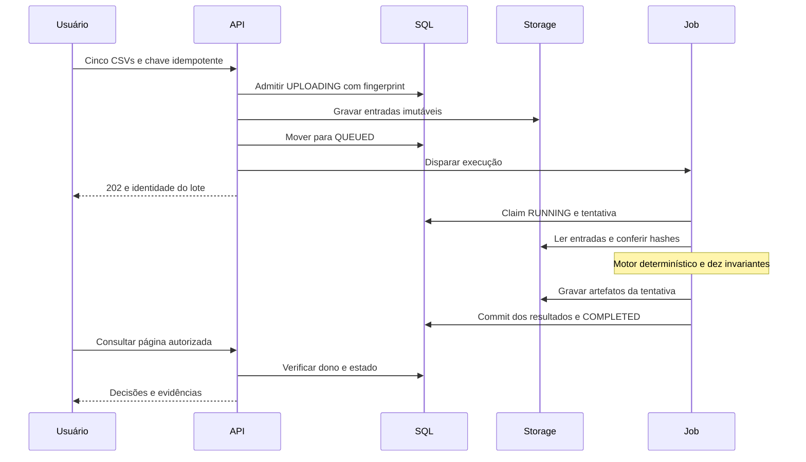
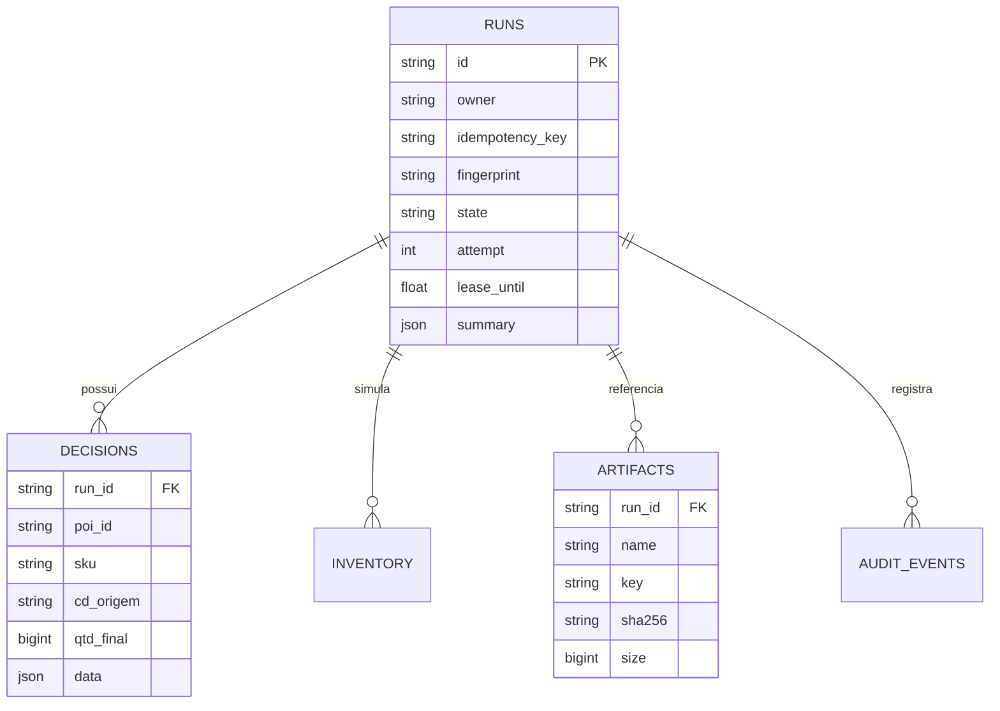

# Contratos de API, dados e sequência

O contrato canônico [openapi.json](api/openapi.json) é gerado do FastAPI e conferido em CI. A interface valida respostas com Zod. Campos adicionais em comandos são rejeitados; quantidades no cliente exigem inteiros seguros de JavaScript. Valores acima desse limite exigem uma evolução de contrato (por exemplo, representação decimal textual), não arredondamento silencioso.

## Requisições e respostas

- Autenticação em toda rota /api/v1, exceto criação de sessão demonstrativa. No GCP, essa criação está desativada e exige-se IAP.
- Mutações requerem origem autorizada, papel e, no demo, X-CSRF-Token recebido em /me.
- Criação: POST /api/v1/reconciliations?policy=strict, multipart com cinco partes files, nomes do case, Idempotency-Key obrigatória. Responde 202 com id e estado; consultar GET até COMPLETED ou FAILED.
- Páginas: items, total, limit, offset; limite de 1 a 100 e offset até 1 milhão. Decisões filtram search/status/cd, ordenam por allowlist e sempre têm desempate estável.
- Erro: code, detail e correlation_id; header X-Correlation-ID permite rastreio. 401 sem identidade, 403 papel/origem/CSRF, 404 lote inacessível/inexistente, 409 estado/idempotência/integridade, 413 tamanho, 422 contrato e 429 capacidade.
- Downloads autorizados verificam SHA-256 antes de responder e usam Content-Disposition attachment. Artifact list inclui nome, bytes e hash. Caminho interno e dono não aparecem na resposta.
- Comparação exige as mesmas cinco hashes de entrada, retorna delta absoluto/percentual e até 100 diferenças; affected_count representa o total. Delta percentual usa a proposta de origem como denominador; origem zero retorna null.

## Sequência de uma execução

Falhas preservam estado e categoria; publicação SQL exige tentativa vigente. Não há transação distribuída entre SQL e Jobs, nem reserva transacional de estoque.

## Modelo persistido

O esquema inicial usa unicidade lógica e transações SQLAlchemy. O diagrama expressa relações de domínio; nem todas estão declaradas como foreign keys no DDL. Sessões demo e capacity_lock são tabelas adicionais. Os cinco hashes são mantidos no resumo e recompostos por página para não duplicar evidência em cada linha.

As chaves CSV e as ambiguidades continuam em [CONTRATOS.md](CONTRATOS.md). Política e versão compõem engine_run_id; id da API identifica a execução. As duas identidades têm finalidades diferentes.
