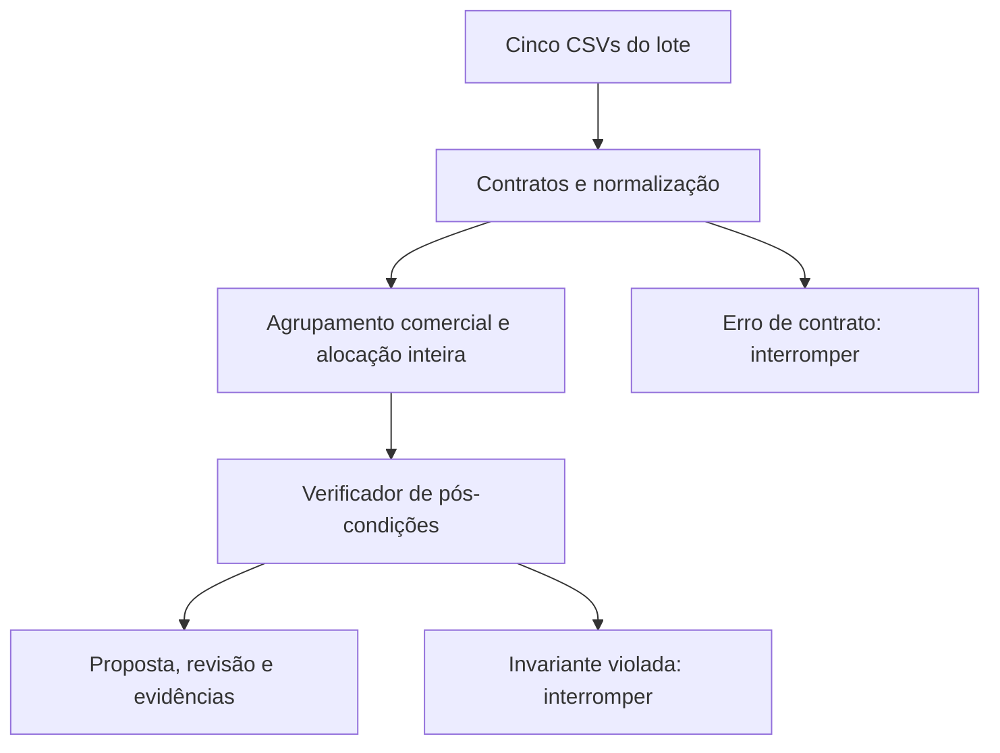

# Arquitetura, formulação e limites

## Fluxo da solução

As saídas só são publicadas quando todas as pós-condições passam. O operador recebe uma proposta local; a aplicação não chama OMS, OTM, WMS ou faturamento.

| Módulo | Responsabilidade |
| --- | --- |
| `models.py` | Contratos do domínio, política e erros distintos |
| `ingest.py` | CSV, integridade de chaves, normalização, cadastros e hashes |
| `engine.py` | Preparação dos grupos, limites, reserva simulada e verificação |
| `report.py` | Artefatos CSV/JSON/HTML e publicação local do lote |
| `cli.py` | Argumentos, códigos de saída e evento estruturado |

## Variáveis e restrições

Para cada POI $i$, sejam demanda $d_i$, sugestão OTM $s_i$, quantidade final $x_i$ e passo de embalagem $m_i$. Se o SKU permite fracionamento, $m_i=1$; caso contrário, é o múltiplo da caixa master.

$$
x_i \in \mathbb{Z}_{\ge 0},\qquad x_i \le \min(d_i,s_i),\qquad x_i \equiv 0 \pmod {m_i}
$$

Para cada par CD/SKU $(c,k)$, com estoque da foto $E_{c,k}$:

$$
\sum_{i:\,CD_i=c,\,SKU_i=k} x_i \le E_{c,k}
$$

OTM ausente, SKU divergente, status não aprovado ou cadastro obrigatório ausente obrigam $x_i=0$ e revisão. Em combos, a restrição se propaga ao grupo inteiro.

Para um grupo de combo $g$, cada componente tem proporção inteira positiva $p_i$. Deve existir um número inteiro de kits $n_g$ tal que:

$$
x_i=p_i n_g \quad \text{para todos os componentes do grupo}
$$

O escopo do grupo é `(pedido_id, cd_origem, cod_franqueado, id_combo_comercial)`. Não se completam kits entre pedidos, franqueados ou CDs diferentes.

## Ajuste conjunto de combo e caixa

Defina $b_i=\min(d_i,s_i)$, e $a_i$ como o estoque **remanescente** do CD/SKU, já descontados os grupos anteriores.

$$
N=\min_i\left(\left\lfloor b_i/p_i\right\rfloor,
                        \left\lfloor a_i/p_i\right\rfloor\right)
$$

Para que $p_i n$ seja múltiplo de $m_i$, $n$ precisa ser múltiplo de $m_i/\operatorname{MDC}(m_i,p_i)$. Combinando as exigências:

$$
K=\operatorname{MMC}_i\left(\frac{m_i}{\operatorname{MDC}(m_i,p_i)}\right),
\qquad n^*=K\left\lfloor N/K\right\rfloor
$$

Todo número viável de kits é múltiplo de $K$ e não supera $N$. Portanto, $n^*$ é o **maior número viável para esse grupo, com o saldo atual**. Esse resultado não demonstra um ótimo global entre todos os pedidos.

Exemplo sintético, diferente da base original: componentes nas proporções 2:3, caixas de 6 e 10, limites 140:210. O passo de kits é `MMC(6/MDC(6,2), 10/MDC(10,3)) = MMC(3,10) = 30`. O teto é 70 kits, logo cabem 60 kits: **120 e 180 peças**. Reduzir cada componente isoladamente não garante essa compatibilidade.

Na política `strict`, para “Zerar se incompleto”, o vetor $b$ é indivisível: ele precisa ser proporcional, inteiro, compatível com embalagem e caber integralmente no saldo atual. Se não couber, o grupo é zerado. A maximização por $n^*$ vale para a regra explícita de ajuste e para o cenário `complete-kits`.

## Estoque compartilhado e determinismo

O ledger é uma cópia da foto, indexada por `(CD, SKU)`. Cada grupo calcula uma solução conjunta antes dos débitos. Nenhum componente é debitado enquanto o grupo está em revisão.

Grupos são ordenados lexicalmente por pedido, CD, franqueado e identificador do grupo. POIs de saída são ordenados por identificador. Essa ordem é estável mesmo se a ordem física das linhas mudar, mas não representa FIFO, urgência ou rentabilidade. `PED-10` pode preceder `PED-2`; não se faz inferência de ordem numérica ou temporal.

Nenhuma sobra é realocada acima do teto original do OTM. Grupos posteriores podem usar o saldo ainda disponível **dentro de sua própria sugestão**, sem aumentar quantidades propostas para compensar reduções anteriores.

## Verificação independente da alocação

O verificador recalcula a soma de consumo por CD/SKU a partir das decisões e a compara à foto e ao ledger. Também confere preservação dos POIs e da identidade das linhas, inteiros não negativos, tetos individuais, cadastros, múltiplos, proporções e política estrita. Ele não considera o próprio débito do alocador uma prova de segurança.

Reutiliza apenas o agrupamento e a definição de bloqueio de cadastro. A verificação de viabilidade matemática é diferente do caminho de alocação. Para reduzir o risco de erro compartilhado na fórmula, os testes comparam 600 cenários a um oráculo de enumeração sem usar MDC/MMC.

## Identidade e integridade do lote

`run_id = SHA256(JSON_canônico(versão, política, hashes_das_entradas, hashes_do_código))`.

Os bytes lidos uma única vez são usados tanto para parsing quanto para hash. A saída não embute relógio ou duração, preservando reprodução integral. O manifesto registra seis hashes de artefatos e exclui a si próprio para evitar autorreferência. Hashes detectam divergência; não são assinatura, autenticação ou prova de origem confiável.

Alterar a ordem física das entradas mantém as decisões, mas muda o hash do arquivo e o `run_id`. Reconciliar novamente as quantidades finais sobre a mesma foto conserva as quantidades neste modelo. Isso **não** significa que seja seguro enviar o lote duas vezes para faturamento: esse fluxo precisa de idempotência transacional externa.

## Complexidade e escala

Com $N$ POIs e $M$ registros de cadastro/OTM/estoque, índices e verificações são aproximadamente lineares; a ordenação dos grupos e saídas custa $O(N\log N)$. A aritmética de MDC/MMC depende também do número de componentes e do tamanho dos inteiros.

O demonstrador mantém dados, decisões e HTML em memória, com custo $O(N+M)$ mais as representações de saída. O limite de 64 MiB é **por arquivo**, não um limite garantido de RAM. O relatório HTML é adequado à amostra, não a milhões de linhas no navegador.

Para escala: particionar por CD, manter todos os pedidos que competem pelo mesmo saldo na mesma unidade de reserva, externalizar o ledger em transação e paginar relatórios. Dividir aleatoriamente arquivos em chunks independentes recriaria o risco de dupla alocação.

## Papel possível de IA

Uma extensão pode consultar motivos e procedimentos para explicar “por que este POI foi zerado?”, agrupar ocorrências e ajudar a redigir uma fila operacional. A fonte das quantidades continua sendo o motor. A ferramenta de consulta deve ser somente leitura, com saída estruturada, referências ao POI e validação dos números contra os artefatos.

Critérios para avaliar essa extensão: correção factual das explicações, cobertura de motivos, afirmações sem evidência, latência e custo. Testar também instruções maliciosas em descrições e impedir que texto de cadastro se transforme em comando. Não há LLM, prompt ou custo de tokens na implementação atual.

## Referências primárias

- [Python: math.gcd e math.lcm](https://docs.python.org/3.12/library/math.html).
- [Python: contratos do módulo csv](https://docs.python.org/3.12/library/csv.html).
- [Python: html.escape](https://docs.python.org/3.12/library/html.html).
- [GitHub: uso seguro de Actions e fixação por SHA](https://docs.github.com/en/actions/reference/security/secure-use).

As regras comerciais e os dados são os fornecidos pelo desafio; a interpretação conservadora é uma premissa explícita desta implementação.
