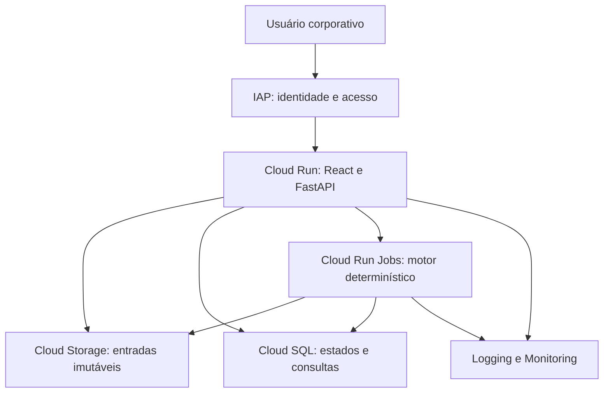
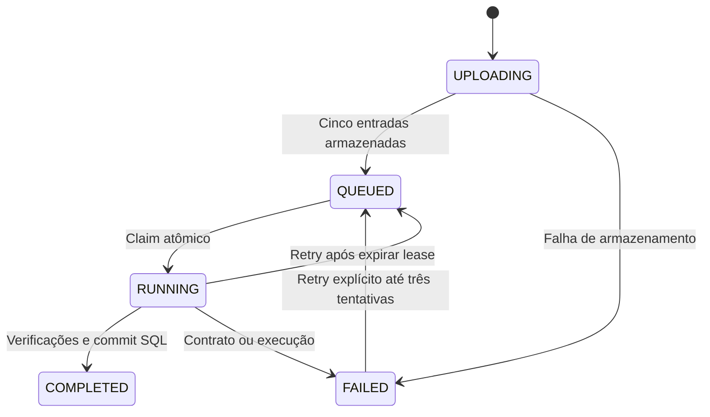

# Arquitetura GCP e fronteiras de validação

## Componentes



Frontend e API compartilham origem e imagem. Evita-se SSR, CORS público e um segundo serviço web sem necessidade. Jobs usam a mesma imagem e outro entrypoint. A CLI e os sete fontes originais do motor permanecem independentes da API.

## Persistência e estados



SQL armazena execução, decisões, inventário, artefatos, auditoria e sessões demo. O ambiente GCP desativa sessões demo. Uma linha de lock serializa a admissão de até quatro execuções ativas no banco inteiro. Há ainda limite por proprietário. Cada worker adquire um claim por UPDATE condicional.

O número da tentativa funciona como token de fencing. Um worker antigo não pode substituir resultados ou marcar falha depois que outro assumiu o lote. Artefatos ficam em prefixos distintos por tentativa. Resultados só são consultáveis quando o estado é COMPLETED e a transação de publicação terminou.

`run_id` da API é identidade opaca da execução, distinta de `engine_run_id`, o hash determinístico de entradas, política e código do motor. Simulações geram nova execução com `parent_id` e preservam o lote de origem.

## Identidade e autorização

IAP habilitado diretamente no serviço protege também o endereço `run.app`. A aplicação valida assinatura, audiência, issuer, expiração e limite de vida do JWT. O papel vem de um mapa de identidades administrado no ambiente, nunca de um header livre ou de um campo do frontend.

Toda consulta de lote, decisão, inventário, comparação, auditoria ou download verifica propriedade. Administradores têm acesso administrativo explícito. Os dois lotes de demonstração são compartilhados somente dentro do ambiente demo autenticado. Ocultar uma ação na interface não substitui a autorização do servidor.

## Armazenamento

Cloud Storage usa acesso uniforme, bloqueio público, versionamento e lifecycle configurável. API e worker recebem `objectCreator` e `objectViewer`, sem permissão para substituir ou apagar objetos. Uploads usam precondição de geração. Downloads são verificados por SHA-256 antes de enviar bytes.

Arquivos locais são apenas o adaptador de desenvolvimento. O modo GCP não depende do disco efêmero para persistir lotes. Temporários servem para cálculo e publicação de uma tentativa. Em caso de falha, objetos órfãos permanecem privados e expiram pela política do bucket.

Cloud SQL oferece consultas paginadas com filtros e índices. Referências aos cinco arquivos são reconstituídas por página a partir dos hashes do lote, evitando armazenar a mesma evidência completa em milhões de linhas. Um benchmark local chegou a aproximadamente 1,1 GB de SQLite para 1 milhão de decisões; modelagem e retenção do PostgreSQL real precisam de carga e análise de custo.

## Infraestrutura

O módulo Terraform configura APIs, service accounts, Cloud SQL com IAM, buckets, registry, Job, serviço IAP, federação GitHub e alerta de falha. Os ambientes dev, staging e production recebem nomes distintos; recomenda-se um projeto GCP por ambiente e estados remotos separados.

O API service usa 2 vCPUs, 4 GiB, concorrência HTTP 1, mínimo zero e máximo duas instâncias. O Job usa 2 vCPUs, 4 GiB, um task, timeout 30 minutos e retry automático zero. Reprocessamento exige estado/lease e tem teto de três tentativas. Esses valores são configuração inicial proposta, não capacidade homologada.

Cloud SQL usa um núcleo e 3,75 GiB, disco inicial de 20 GB com limite de autoresize de 100 GB e backups. Produção propõe alta disponibilidade regional. Conexão pública do SQL exige Connector, IAM e transporte criptografado, sem lista pública de redes autorizadas. Uma organização pode exigir IP privado e VPC; essa alteração depende da política corporativa.

## Configuração e implantação

Pré-requisitos: projeto autorizado, faturamento, identidades corporativas, bootstrap do IAP/OAuth quando necessário, bucket de estado e permissões de administração do banco. Os usuários IAM da aplicação precisam de grants SQL sobre as tabelas; o schema não é criado automaticamente no startup GCP.

```bash
terraform -chdir=infra init -backend=false
terraform -chdir=infra validate
terraform -chdir=infra plan -var-file=environments/staging.tfvars
```

`plan` e `apply` exigem credenciais e autorização. O terceiro comando é uma instrução para o operador, não uma ação realizada nesta entrega. Usar imagem por digest e configurar as identidades efetivas. Consultar [operação](OPERACAO_ENTERPRISE.md) para migração, canário e rollback.

## Custos e escolhas proporcionais

A arquitetura não inclui Redis, Kubernetes, Kafka, vetor ou LLM obrigatório. Cloud SQL tem custo fixo mesmo com API em zero instâncias. O limite de quatro execuções ativas reduz a multiplicação de custo computacional, mas não é orçamento financeiro. Definir budget e alertas no projeto autorizado antes de executar lotes reais.

## Referências primárias verificadas

- [IAP diretamente no Cloud Run](https://docs.cloud.google.com/run/docs/securing/identity-aware-proxy-cloud-run).
- [Validação dos headers assinados do IAP](https://docs.cloud.google.com/iap/docs/signed-headers-howto).
- [Executar Jobs com overrides](https://docs.cloud.google.com/run/docs/execute/jobs).
- [Autenticação IAM no Cloud SQL](https://docs.cloud.google.com/sql/docs/postgres/iam-authentication).
- [Workload Identity Federation com pipelines](https://docs.cloud.google.com/iam/docs/workload-identity-federation-with-deployment-pipelines).

Validação Terraform e testes de SDK não comprovam conectividade, grants, OAuth, desempenho ou recuperação no GCP. Esses itens permanecem para homologação em ambiente autorizado.
